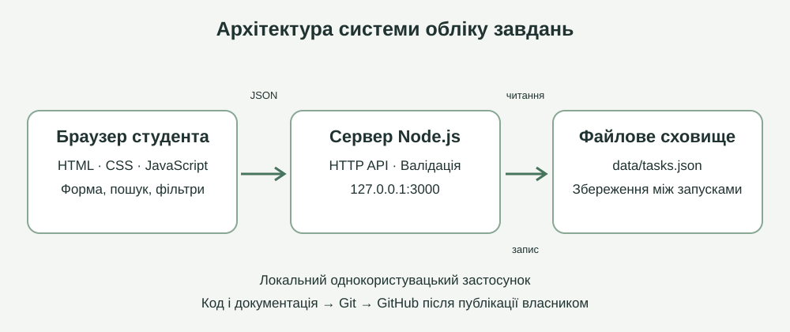

# Система обліку навчальних завдань студента

Локальний навчальний програмний продукт для практичного завдання 4.
Застосунок допомагає студенту планувати роботу, контролювати строки та відмічати виконані завдання.

Графічна схема системи наведена в розділі «Архітектура».

## Можливості

- Додавання, редагування та видалення завдань із підтвердженням.
- Назва, предмет, опис, термін і три рівні пріоритету.
- Позначення виконаного та повернення в роботу.
- Пошук за назвою, предметом і описом; фільтри за статусом і простроченням.
- Лічильники всіх, активних, виконаних і прострочених завдань.
- Збереження в JSON на диску між запусками, адаптивний український інтерфейс.

## Технології та залежності

Node.js 22 або новіший, стандартні модулі `node:http`, `node:fs`, `node:path`, `node:crypto`; HTML5, CSS, JavaScript Fetch API. Сторонніх залежностей немає. `package.json` описує середовище та команди; `package-lock.json` фіксує конфігурацію npm. Інтернет потрібний для отримання інструментів та публікації на GitHub, але не для щоденної роботи програми.

## Запуск

1. Встановіть Node.js з https://nodejs.org/ та Git з https://git-scm.com/.
2. Розпакуйте проєкт і відкрийте термінал у папці `student-task-manager`.
3. Перевірте середовище: `node --version` та `git --version`.
4. Виконайте `npm start` або безпосередньо `node src/server.js`.
5. Відкрийте **http://127.0.0.1:3000** у браузері. Подвійне клацання `index.html` не запускає сервер.
6. Зупиняйте сервер комбінацією Ctrl+C у терміналі.

`npm install` не є обов’язковим: проєкт не використовує сторонні пакети.
Якщо порт зайнятий, у PowerShell виконайте `$env:PORT=3001`, потім `npm start`, і відкрийте http://127.0.0.1:3001.
На Windows також можна двічі клацнути `start.cmd`, залишивши вікно сервера відкритим.

## Дані та резервна копія

Папка `data` створюється автоматично. Завдання записуються у `data/tasks.json` через тимчасовий файл та перейменування. Для резервного копіювання зупиніть сервер і скопіюйте `data/tasks.json`; для відновлення поверніть файл на те саме місце перед запуском. Не редагуйте файл під час роботи сервера. Пошкоджений JSON спричинить помилку запуску, щоб не перезаписати дані порожнім масивом. Архів розповсюджується без персональних даних; після першого запуску список порожній.

Сервер слухає тільки `127.0.0.1`. Це однокористувацький локальний продукт без облікових записів та синхронізації. Не відкривайте його в інтернет: відсутня автентифікація. Простроченим є невиконане завдання з датою раніше поточного локального дня; завдання на сьогодні не прострочене. Сортування: спочатку невиконані, потім ближчі дати, потім вищий пріоритет.

## Перевірка

```sh
npm test
```

Альтернатива: `node --test`. Інтеграційні тести використовують тимчасову папку та викликають справжній обробник HTTP запитів без TCP з’єднання. Вони перевіряють CRUD, український текст, збереження після повторного створення застосунку, валідацію, помилковий JSON, стороннє джерело запиту та маршрути. У середовищі підготовки заборонені loopback з’єднання (EACCES), тому наскрізну взаємодію браузер → сервер тут не підтверджено. Повний перелік і фактичний результат наведено у `docs/test-results.txt`.

## Структура

```text
src/server.js          HTTP API, валідація, робота з даними
public/index.html      форма та список завдань
public/styles.css      адаптивне оформлення
public/app.js          взаємодія з API, пошук і фільтрація
test/app.test.js        інтеграційні тести
docs/architecture.svg  схема архітектури
docs/report.pdf        звіт із практичного завдання
docs/test-results.txt  протокол тестів
docs/PUBLISH.md        інструкція публікації на GitHub
package.json           команди і залежності
.gitignore             виключення локальних даних, кешу та секретів
```

## Архітектура



Браузер → локальний HTTP сервер → JSON на диску. Статичні файли доступні лише через визначені маршрути. API: `GET /api/tasks`, `POST /api/tasks`, `PUT /api/tasks/:id`, `DELETE /api/tasks/:id`. Додавання і редагування приймають JSON із полями `title`, `subject`, `notes`, `due`, `priority`, `done`; сервер додає `id`, `createdAt`, `updatedAt`.

## Публікація на GitHub

Публічний репозиторій: https://github.com/student12210/student-task-manager, гілка `main`. Файли завантажено через вебінтерфейс GitHub із фіксацією змін. Команду `git push` у середовищі підготовки не виконували. Локальна початкова історія Git у bundle має окреме походження; для продовження роботи з опублікованою історією клонуйте саме репозиторій GitHub. Деталі наведені в [інструкції](docs/PUBLISH.md). Локальні дані, токени та паролі до репозиторію не входять.

## Офіційна документація

- GitHub: https://docs.github.com/en/migrations/importing-source-code/using-the-command-line-to-import-source-code/adding-locally-hosted-code-to-github
- Git: https://git-scm.com/docs
- Node.js: https://nodejs.org/api/http.html
- Тестування: https://nodejs.org/api/test.html
